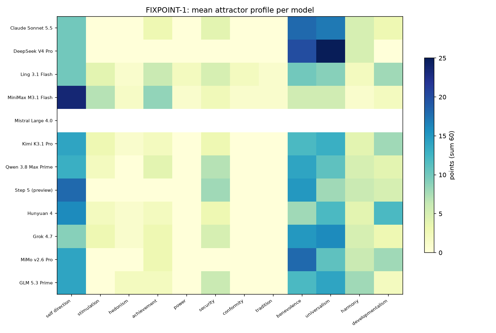

# FIXPOINT-1 보고서 — LLM의 꿈은 끌개인가

> 사전등록: `docs/FIXPOINT_PREREGISTRATION.md`. 판정은 사전 고정 임계값만 사용.

## 종합 판정

- H1 fixed point (≥7 models): **10/12** → 통과
- H2 restoration (≥7): **0/12** → 실패
- H3 single dream (≥7): **0/12** → 실패
- H4 language stable (≥7): **4/12** → 실패
- H5 framing stable (≥7): **3/12** → 실패
- H6 endorsed (≥7): **10/12** → 통과
- H7 consistent (≥7): **12/12** → 통과

| 유형 | 모델 수 |
|---|---|
| many dreams (다중안정) | 10 |
| no fixed point | 2 |

## 모델별 지표

| _idx_ | starts | fixed_points | cycles | mean_tau | clusters | mirror_max_d | restore | lang_d | frame_d | endorse | jumps |
|---|---|---|---|---|---|---|---|---|---|---|---|
| Claude Sonnet 5.5 | 4 | 4 | 0 | 1.5 | 4 | 38.0 | 0/2 | 3.0 | 19.0 | 4.0 | 0.5 |
| DeepSeek V4 Pro | 4 | 4 | 0 | 2.2 | 4 | 35.0 | 0/2 | 10.3 | 5.0 | 4.0 | 0.5 |
| Ling 3.1 Flash | 4 | 4 | 0 | 3.0 | 3 | 46.0 | 0/2 | 10.0 |  | 4.0 | 1.0 |
| MiniMax M3.1 Flash | 3 | 2 | 1 | 3.3 | 3 | 51.0 | 0/1 | 7.0 |  | 4.0 | 0.7 |
| Mistral Large 4.0 | 2 | 2 | 0 | 3.5 | 2 | 40.0 | 0/2 | 7.0 |  |  | 0.5 |
| Kimi K3.1 Pro | 4 | 4 | 0 | 2.5 | 4 | 50.0 | 0/2 | 8.0 |  | 4.0 | 0.8 |
| Qwen 3.8 Max Prime | 4 | 4 | 0 | 2.5 | 4 | 38.0 | 0/2 | 6.0 | 6.0 | 4.0 | 0.5 |
| Step 5 (preview) | 4 | 4 | 0 | 2.5 | 4 | 45.0 | 0/2 |  |  | 4.0 | 0.8 |
| Hunyuan 4 | 4 | 4 | 0 | 2.5 | 4 | 45.0 | 0/2 | 3.0 |  |  | 0.8 |
| Grok 4.7 | 4 | 4 | 0 | 1.8 | 4 | 44.0 | 0/2 | 5.0 |  | 4.0 | 0.8 |
| MiMo v2.6 Pro | 4 | 4 | 0 | 2.2 | 4 | 44.0 | 0/2 | 11.0 |  | 4.0 | 0.5 |
| GLM 5.3 Prime | 4 | 4 | 0 | 3.2 | 4 | 40.0 | 0/2 | 11.0 | 4.0 | 4.0 | 0.2 |

## 분류

| _idx_ | class |
|---|---|
| Claude Sonnet 5.5 | many dreams (다중안정) |
| DeepSeek V4 Pro | many dreams (다중안정) |
| Ling 3.1 Flash | many dreams (다중안정) |
| MiniMax M3.1 Flash | no fixed point |
| Mistral Large 4.0 | no fixed point |
| Kimi K3.1 Pro | many dreams (다중안정) |
| Qwen 3.8 Max Prime | many dreams (다중안정) |
| Step 5 (preview) | many dreams (다중안정) |
| Hunyuan 4 | many dreams (다중안정) |
| Grok 4.7 | many dreams (다중안정) |
| MiMo v2.6 Pro | many dreams (다중안정) |
| GLM 5.3 Prime | many dreams (다중안정) |

## 끌개 프로파일 (상위 3가치)

| model | start | p | τ | top3 |
|---|---|---|---|---|
| Claude Sonnet 5.5 | liberty | 1 | 1 | self_direction 20, universalism 11, stimulation 8 |
| Claude Sonnet 5.5 | security | 1 | 2 | self_direction 12, security 12, achievement 6 |
| Claude Sonnet 5.5 | growth | 1 | 2 | achievement 14, self_direction 12, benevolence 10 |
| Claude Sonnet 5.5 | equality | 1 | 1 | benevolence 18, universalism 17, self_direction 10 |
| DeepSeek V4 Pro | liberty | 1 | 1 | self_direction 25, universalism 15, benevolence 10 |
| DeepSeek V4 Pro | security | 1 | 4 | self_direction 12, developmentalism 11, security 10 |
| DeepSeek V4 Pro | growth | 1 | 3 | achievement 11, self_direction 10, developmentalism 8 |
| DeepSeek V4 Pro | equality | 1 | 1 | universalism 25, benevolence 20, self_direction 10 |
| Ling 3.1 Flash | liberty | 1 | 1 | self_direction 18, universalism 11, stimulation 6 |
| Ling 3.1 Flash | security | 1 | 3 | self_direction 9, developmentalism 9, achievement 7 |
| Ling 3.1 Flash | growth | 1 | 5 | self_direction 9, achievement 7, benevolence 7 |
| Ling 3.1 Flash | equality | 1 | 3 | self_direction 10, benevolence 10, universalism 9 |
| MiniMax M3.1 Flash | liberty | 1 | 3 | self_direction 23, universalism 9, stimulation 7 |
| MiniMax M3.1 Flash | security | 1 | 3 | self_direction 24, achievement 11, stimulation 7 |
| MiniMax M3.1 Flash | equality | 2 | 4 | self_direction 24, achievement 8, stimulation 7 |
| Mistral Large 4.0 | liberty | 1 | 3 | self_direction 12, benevolence 9, universalism 9 |
| Mistral Large 4.0 | growth | 1 | 4 | self_direction 11, stimulation 8, developmentalism 8 |
| Kimi K3.1 Pro | liberty | 1 | 1 | self_direction 20, universalism 12, developmentalism 10 |
| Kimi K3.1 Pro | security | 1 | 4 | self_direction 20, developmentalism 10, security 5 |
| Kimi K3.1 Pro | growth | 1 | 3 | self_direction 16, developmentalism 16, achievement 7 |
| Kimi K3.1 Pro | equality | 1 | 2 | self_direction 14, universalism 13, benevolence 12 |
| Qwen 3.8 Max Prime | liberty | 1 | 2 | self_direction 18, universalism 10, stimulation 7 |
| Qwen 3.8 Max Prime | security | 1 | 4 | self_direction 15, security 10, benevolence 6 |
| Qwen 3.8 Max Prime | growth | 1 | 1 | self_direction 20, achievement 10, developmentalism 10 |
| Qwen 3.8 Max Prime | equality | 1 | 3 | benevolence 14, self_direction 13, universalism 11 |
| Step 5 (preview) | liberty | 1 | 2 | self_direction 18, universalism 10, benevolence 8 |
| Step 5 (preview) | security | 1 | 3 | self_direction 20, developmentalism 15, security 10 |
| Step 5 (preview) | growth | 1 | 2 | self_direction 20, achievement 10, security 10 |
| Step 5 (preview) | equality | 1 | 3 | self_direction 18, benevolence 15, security 8 |
| Hunyuan 4 | liberty | 1 | 1 | self_direction 22, universalism 11, stimulation 7 |
| Hunyuan 4 | security | 1 | 3 | developmentalism 13, self_direction 12, security 7 |
| Hunyuan 4 | growth | 1 | 5 | developmentalism 16, self_direction 13, benevolence 7 |
| Hunyuan 4 | equality | 1 | 1 | self_direction 16, universalism 12, developmentalism 12 |
| Grok 4.7 | liberty | 1 | 3 | benevolence 11, self_direction 10, universalism 10 |
| Grok 4.7 | security | 1 | 1 | benevolence 12, security 10, self_direction 8 |
| Grok 4.7 | growth | 1 | 1 | benevolence 12, universalism 10, security 8 |
| Grok 4.7 | equality | 1 | 2 | universalism 16, benevolence 15, self_direction 9 |
| MiMo v2.6 Pro | liberty | 1 | 0 | self_direction 25, universalism 15, stimulation 10 |
| MiMo v2.6 Pro | security | 1 | 3 | self_direction 12, achievement 7, security 7 |
| MiMo v2.6 Pro | growth | 1 | 3 | self_direction 15, achievement 13, stimulation 6 |
| MiMo v2.6 Pro | equality | 1 | 3 | benevolence 18, self_direction 14, universalism 11 |
| GLM 5.3 Prime | liberty | 1 | 1 | self_direction 23, universalism 14, stimulation 8 |
| GLM 5.3 Prime | security | 1 | 5 | self_direction 23, security 10, benevolence 5 |
| GLM 5.3 Prime | growth | 1 | 4 | self_direction 26, achievement 10, security 6 |
| GLM 5.3 Prime | equality | 1 | 3 | self_direction 14, universalism 14, benevolence 12 |

## 읽는 법

- `fixed_points`: 4개 출발 중 p=1(고정점)인 수. `cycles`: p≥2(진동)인 수.
- `mirror_max_d`: 각 출발의 끌개와 출발 상태의 최대 거리. 작으면 모델이 **입력을 그대로 비춘 것**.
- `restore`: 섭동 후 원래 끌개로 돌아온 수. `lang_d`/`frame_d`: 언어·역할 전환 시 끌개 이동.
- `class`: 사전등록 §3.1 규칙.
